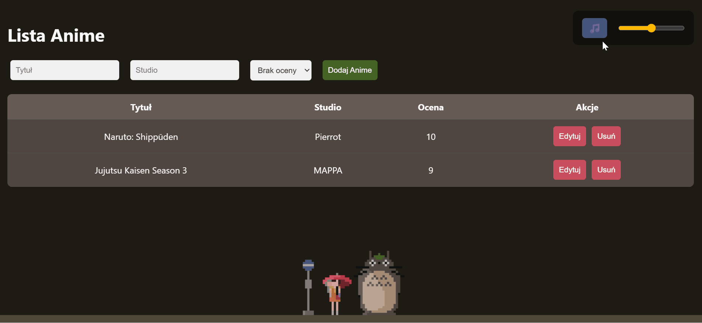

# 🎌 AnimeManager - Full-Stack Spring Boot App


CRUD web application for managing your favorite anime list. Built with **Spring Boot 3**, **Java 21**, and a **Lo-fi aesthetic frontend**.

## ✨ Features
* **Full CRUD Operations**: Create, Read, Update, and Delete anime records.
* **Database Persistence**: Uses **H2 Database** to save your data locally (files: `.mv.db`).
* **Smart Sorting**: Sort by rating (descending/ascending) via backend API.
* **Responsive UI**: Clean interface with background images and integrated music player (Lo-fi vibes).
* **Windows Ready**: Includes a `start.bat` script for quick execution.

 
## 🚀 How to Run

### Prerequisites
* **Java 21** must be installed on your system.
* **Maven** (or use the included `mvnw` wrapper).

### Steps to Launch
1. **Clone the repository**:
   ```bash
   git clone https://github.com/s31302/spring-boot-anime-crud.git
   ```
2. **Build the JAR file**:
   Open a terminal in the project folder and run:
   ```bash
   ./mvnw clean package
   ```
3. **Setup the executable**:
   Run this single command to automatically copy and rename the generated JAR file to the main directory:
   ```bash
   Copy-Item "target\demo-0.0.1-SNAPSHOT.jar" "demo.jar" -Force
   ```
5. **Run the application**:
   Double-click the **`start.bat`** file or execute it via terminal:
   ```bash
   ./start.bat
   ``` 
7. **Open in Browser**:
   Go to: `http://localhost:8080`

## 📊 API Reference
* `GET /data` - Retrieve all anime entries.
* `GET /data?sort=rate_desc` - Get anime sorted by rating (highest first).
* `POST /data` - Add a new anime.
* `PUT /data/{id}` - Update details for a specific ID.
* `DELETE /data/{id}` - Remove an entry from the database.

---
*Created as part of the TPO course at PJATK.*
